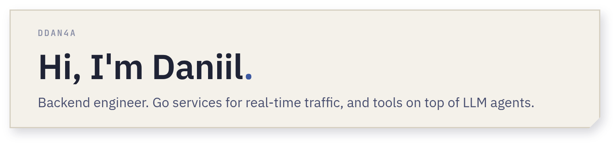
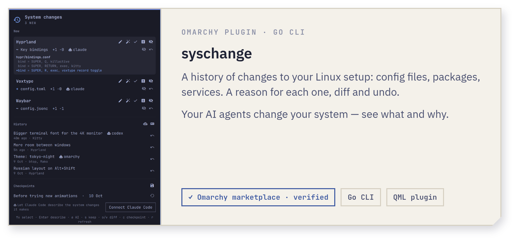
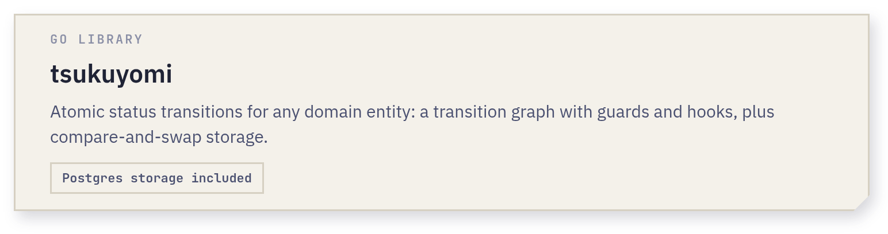
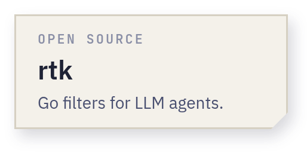
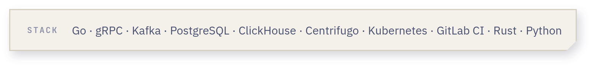

<!-- Cards are rendered from assets/src/cards.html by assets/src/render.sh. -->

  <picture><source media="(prefers-color-scheme: dark)" srcset="./assets/hero-dark.png" /></picture>

  <a href="https://github.com/dDan4a/syschange"><picture><source media="(prefers-color-scheme: dark)" srcset="./assets/syschange-dark.png" /></picture></a>

  <a href="https://github.com/dDan4a/agent-skills"><picture><source media="(prefers-color-scheme: dark)" srcset="./assets/agent-skills-dark.png" /></picture></a><a href="https://github.com/dDan4a/tsukuyomi"><picture><source media="(prefers-color-scheme: dark)" srcset="./assets/tsukuyomi-dark.png" /></picture></a><a href="https://github.com/rtk-ai/rtk/pulls?q=author%3AdDan4a"><picture><source media="(prefers-color-scheme: dark)" srcset="./assets/rtk-dark.png" /></picture></a>

  <picture><source media="(prefers-color-scheme: dark)" srcset="./assets/stack-dark.png" /></picture>

  <a href="mailto:danshtal@gmail.com" title="Email"><picture><source media="(prefers-color-scheme: dark)" srcset="./assets/mail-dark.png" /></picture></a>

